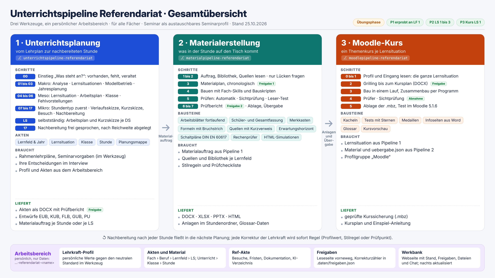
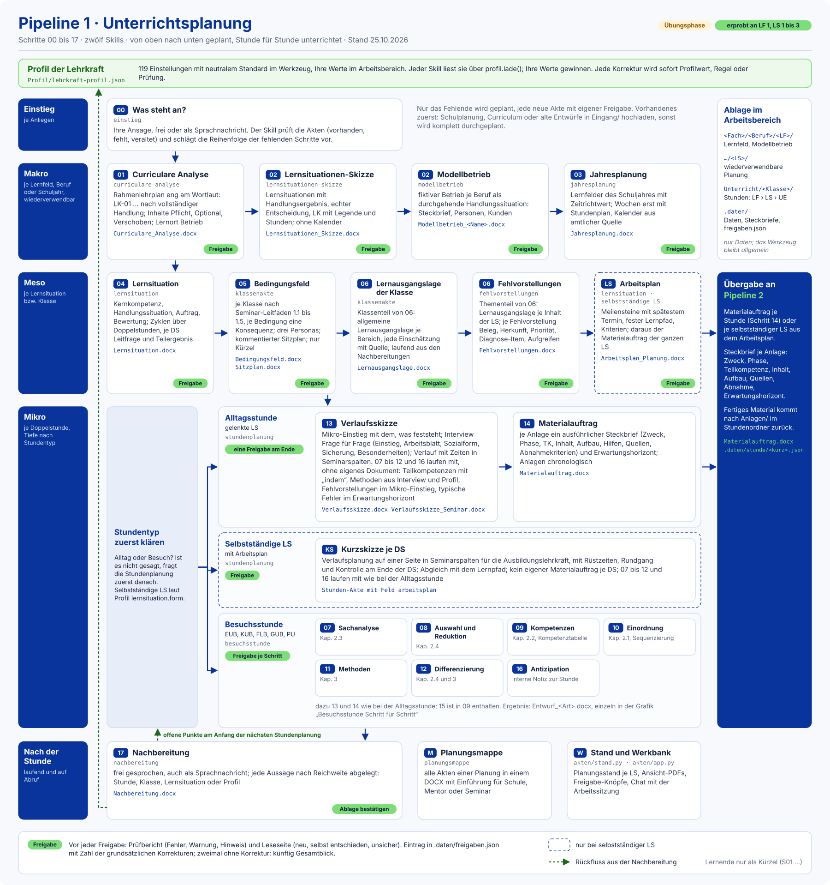
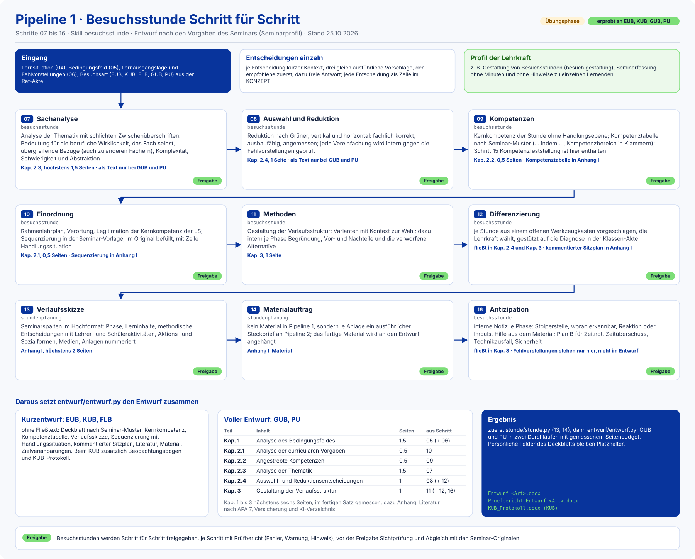
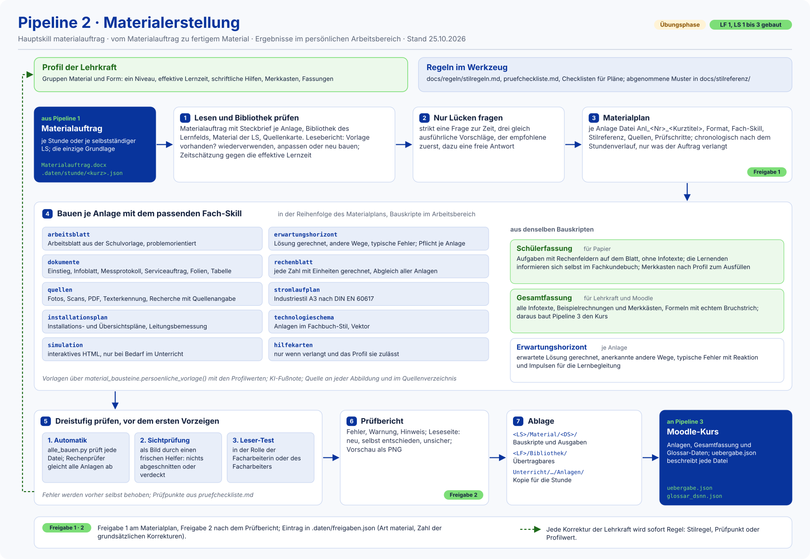
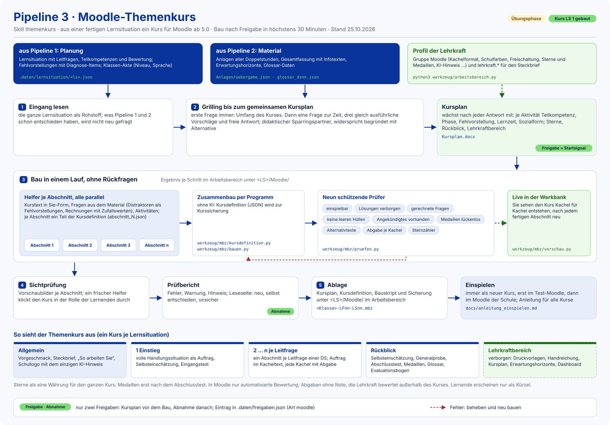

# KI-Unterrichtswerkstatt

**Unterrichtsplanung, Material und Moodle-Kurse für berufsbildende Schulen, KI-gestützt.** Für Lehrkräfte im
Vorbereitungsdienst und alle, die es sonst brauchen können. Entstanden im Referendariat an einer berufsbildenden
Schule in Niedersachsen, dort im Alltag erprobt und mit Zustimmung der Seminarleitung veröffentlicht.

**Die Lehrkraft entscheidet, die KI fragt, entwirft, prüft und dokumentiert.** Grundlage ist
[Claude Code](https://claude.com/claude-code): Die Arbeit läuft als Gespräch, die KI stellt eine Frage nach der
anderen, baut daraus Word-Dokumente, Material und Kurse und legt jede Entscheidung nachvollziehbar ab.

## Was es ist

Drei Werkzeuge, die nacheinander arbeiten, und ein persönlicher Arbeitsbereich je Lehrkraft:

| Ordner | Pipeline | Was herauskommt |
|---|---|---|
| [`unterrichtspipeline-referendariat/`](unterrichtspipeline-referendariat/) | 1 · Unterrichtsplanung | vom Rahmenlehrplan über Lernsituationen bis zur Doppelstunde: curriculare Analyse, Lernsituationen, Klassen-Akte, Fehlvorstellungen, Verlaufsskizze, Materialauftrag, Besuchsentwürfe (EUB bis PU) nach Seminarvorgabe, Nachbereitung |
| [`materialpipeline-referendariat/`](materialpipeline-referendariat/) | 2 · Materialerstellung | aus dem Materialauftrag fertiges Material: Arbeitsblätter, Infoblätter, Erwartungshorizonte, Rechnungen, Diagramme, Folien, Tabellen (DOCX, PPTX, XLSX, HTML) |
| [`moodlepipeline-referendariat/`](moodlepipeline-referendariat/) | 3 · Moodle-Kurs | aus Planung und Material einer Lernsituation ein Themenkurs als Kurssicherung (.mbz) zum Einspielen |
| `unterrichtspipeline-referendariat-<name>/` | Arbeitsbereich | **Ihr eigenes, privates Repository**: Profil, Akten, Material, Kurse. Gehört nie in dieses Repository |

**Werkzeug und Arbeitsbereich sind getrennt.** Dieses Repository enthält nur Allgemeines: Skills (Arbeitsanleitungen
für die KI), Generatoren, Regeln, neutrale Vorlagen. Alles Persönliche (Schule, Seminar, Fächer, Klassen, Vorlieben,
Planungen) steht in Ihrem Arbeitsbereich, vor allem im **Lehrkraft-Profil**. Darum passt dasselbe Werkzeug für jedes
Fach: Das Vorgehen in Planung, Material und Moodle ist für alle gleich, die Anpassung steckt im Profil.

## Wie es gedacht ist

- **Eine Frage zur Zeit.** Jede Entscheidung kommt mit kurzem Kontext und drei gleich ausführlichen Vorschlägen
  (der empfohlene zuerst); Sie können immer auch frei antworten.
- **Begründeter Widerspruch.** Hält die KI etwas anderes für didaktisch oder fachlich besser, sagt sie es von sich aus
  und nennt eine Alternative. Entscheiden tun Sie.
- **Prüfbericht vor jeder Freigabe.** Jedes Dokument kommt mit Fehlern, Warnungen und Hinweisen; eine Leseseite nennt,
  was die KI selbst entschieden hat und wo sie unsicher ist. Sie müssen nicht alles gegenlesen.
- **Aus Korrekturen lernen.** Jede Korrektur wird sofort eine Regel (Profilwert, Stilregel oder Prüfung), damit sie
  nicht zweimal nötig ist.
- **Rangfolge:** Ihre Ansage > Seminarvorgaben > vorhandenes Material der Schule > Vorgabe der Pipeline.
- **Problemorientiert.** Material nimmt nichts vorweg: erst das Problem, dann informieren sich die Lernenden und
  planen selbst.
- **Datenschutz.** Lernende nur als Kürzel (S01 …), nie mit Namen. Alles Persönliche bleibt in Ihrem privaten
  Arbeitsbereich; Git ist dort die Sicherung.

## Der Ablauf im Einzelnen

### 1 · Unterrichtsplanung

Von der Jahresplanung über Lernfeld und Lernsituation bis zur einzelnen Doppelstunde, danach die Nachbereitung, die in
die nächste Planung einfließt. Jeder Schritt ist ein Skill mit eigener Freigabe; der Einstieg „Was steht an?“ prüft,
was schon da ist, und schlägt nur die fehlenden Schritte vor.

Für Unterrichtsbesuche plant der Skill `besuchsstunde` Entscheidung für Entscheidung und setzt den Entwurf nach den
Vorgaben Ihres Seminars zusammen (Kurzentwurf oder voller Entwurf mit Seitenbudget). Das Seminar ist ein
austauschbares **Seminarprofil** unter
[`unterrichtspipeline-referendariat/seminare/`](unterrichtspipeline-referendariat/seminare/); mitgeliefert ist ein
Profil für ein Studienseminar für berufsbildende Schulen. Für ein anderes Seminar legt die Einrichtung aus Ihren
Seminarunterlagen ein eigenes an.

### 2 · Materialerstellung

Aus dem freigegebenen Materialauftrag entsteht fertiges Material: erst die Bibliothek des Lernfelds prüfen
(wiederverwenden, anpassen, neu), dann ein Materialplan zur Freigabe, dann bauen mit den Fach-Skills, prüfen
(Automatik, Sichtprüfung, Leser-Test) und mit Prüfbericht zur zweiten Freigabe. Jede Lösung wird gerechnet, nicht
geschätzt; jede Anlage hat einen Erwartungshorizont.

### 3 · Moodle-Kurs

Aus Planung und Material einer ganzen Lernsituation wird ein Themenkurs: Grilling bis zum Kursplan (Freigabe), Bau in
einem Lauf, automatische Prüfer, Sichtprüfung, Abnahme, Kurssicherung (.mbz) zum Einspielen als neuer Kurs. Moodle
ab 5.0.

Weitere Übersichten (jede Pipeline einzeln, Planungsebenen, Skill-Fahrplan zum Anklicken) liegen in
[`unterrichtspipeline-referendariat/docs/visualisierung/`](unterrichtspipeline-referendariat/docs/visualisierung/).

## Was Sie brauchen

- ein **GitHub-Konto** (kostenlos) für Ihren privaten Arbeitsbereich,
- **Claude Code** mit einem Claude-Abo (Pro oder höher): im Browser oder in der App unter
  [claude.ai/code](https://claude.ai/code) (läuft in der Cloud, gut am Tablet) oder auf dem eigenen Rechner,
- auf dem eigenen Rechner zusätzlich Python 3, Git und LibreOffice; für Material mit Formeln und Schaltplänen
  LuaLaTeX. Das Skript `materialpipeline-referendariat/werkzeug/einrichten.sh` installiert unter Linux alles, was
  fehlt; in Cloud-Sitzungen läuft es beim Start von selbst.

## Installation in fünf Schritten

Die ausführliche Fassung mit Erklärungen steht in [`ANLEITUNG.md`](ANLEITUNG.md).

1. **GitHub-Konto** anlegen (kostenlos), falls noch keins da ist.
2. **Zwei Repositories:** dieses Repository mit **Fork** in Ihr Konto übernehmen und einen **privaten** Arbeitsbereich
   `unterrichtspipeline-referendariat-<ihr name>` anlegen ([vorausgefüllter Link](https://github.com/new?name=unterrichtspipeline-referendariat-IHRNAME&visibility=private&description=Pers%C3%B6nlicher+Arbeitsbereich+zur+KI-Unterrichtswerkstatt)). Dann unter
   [claude.ai/connect-github](https://claude.ai/connect-github) Claude Zugriff auf beide geben.
3. **Sitzung starten** unter [claude.ai/code](https://claude.ai/code) mit beiden Repositories (oder am eigenen Rechner
   in der Wurzel dieses Repositorys). Die Skills aller drei Pipelines werden dann gefunden.
4. **Startprompt einfügen** aus [`STARTPROMPT.md`](STARTPROMPT.md). Die KI richtet den Arbeitsbereich ein und führt
   Sie durch ein Interview (Schule, Seminar, Fächer, didaktische Quellen, eigene Unterlagen, Vorlieben). Daraus entsteht Ihr
   Lehrkraft-Profil.
5. **Loslegen:** sagen, was ansteht, etwa „Ich muss LF 3 planen“, „nächste Woche ist mein Unterrichtsbesuch“ oder
   „Material für DS 2 bauen“.

## Weitergeben und aktuell halten

- **Weitergeben:** einfach den Link zu diesem Repository teilen. Jede Lehrkraft legt ihren eigenen privaten
  Arbeitsbereich an; geteilt wird nur das Werkzeug.
- **Aktualisieren:** in Ihrem Fork **Sync fork** tippen (am eigenen Rechner zusätzlich `git pull`). Ihr Arbeitsbereich
  bleibt unberührt, weil er ein eigenes Repository ist.
- **Eigene Verbesserungen:** Persönliche Vorlieben gehören ins Profil, nicht ins Werkzeug. Allgemeine Verbesserungen
  (neue Prüfung, neuer Skill, ein neues Seminarprofil) gern als Pull Request oder Issue.
- **Nie hochladen:** Namen von Lernenden, Noten, echte Klassendaten. Sie stehen nur im privaten Arbeitsbereich und
  dort nur als Kürzel.

## Fächer, Fachpakete und Seminare

- **Fachneutral:** Planung, Material und Moodle funktionieren für jedes Fach der berufsbildenden Schule. Wo ein Fach
  kein Arbeitsblatt im üblichen Sinn kennt (etwa ein Praxisfach wie Sport), passt das Vorgehen noch nicht überall;
  Rückmeldungen dazu sind besonders willkommen.
- **Fachpaket Elektrotechnik:** Stromlaufpläne, Installationspläne, Technologieschemata und Simulationen gehören zu
  einem Fachpaket, das nur mit dem Profilwert `fach.elektrotechnik` aktiv ist.
- **Seminarprofil:** Besuchsformen, Gliederung, Seitenbudget, Versicherung und KI-Hinweis kommen aus
  `unterrichtspipeline-referendariat/seminare/<id>/seminar.json`. Ein neues Seminar lässt sich aus den eigenen
  Seminarunterlagen anlegen.
- **Schule, Logo, Modellbetrieb:** aus dem Profil; ohne Angabe neutral (BBS Musterstadt, Platzhalter-Logo,
  Musterbetrieb GmbH).

## Wo was steht

| Thema | Datei |
|---|---|
| Arbeitsweise mit der Lehrkraft | [`unterrichtspipeline-referendariat/docs/ARBEITSWEISE.md`](unterrichtspipeline-referendariat/docs/ARBEITSWEISE.md) |
| alle Profilwerte mit neutralem Standard | [`unterrichtspipeline-referendariat/profil/vorlage.json`](unterrichtspipeline-referendariat/profil/vorlage.json) |
| Skills je Pipeline | `*/.claude/skills/` in den drei Ordnern |
| Regeln für Material (Stil, Prüfcheckliste) | [`materialpipeline-referendariat/docs/regeln/`](materialpipeline-referendariat/docs/regeln/) |
| Kurs im Moodle der Schule einspielen | [`moodlepipeline-referendariat/docs/anleitung_einspielen.md`](moodlepipeline-referendariat/docs/anleitung_einspielen.md) |
| Gerüst eines Arbeitsbereichs | [`unterrichtspipeline-referendariat/docs/arbeitsbereich/repo-geruest/`](unterrichtspipeline-referendariat/docs/arbeitsbereich/repo-geruest/) |

## KI-Transparenz und Grenzen

- Material trägt eine KI-Fußnote, Besuchsentwürfe eine KI-Übersicht nach Seminarvorgabe, der Moodle-Kurs einen
  KI-Hinweis. Prüfen Sie, was Ihr Seminar und Ihre Schule verlangen.
- Die KI macht Fehler. Prüfberichte und Rechenprüfer fangen viel ab, ersetzen aber nicht Ihren fachlichen Blick.
- Rahmenlehrpläne und Seminarunterlagen sind nicht enthalten; die Einrichtung fragt danach oder lädt sie aus
  amtlicher Quelle.
- Das Projekt ist ein persönliches Werkzeug aus dem Referendariat, kein Produkt. Es wird weiterentwickelt, solange
  es im Alltag gebraucht wird.
