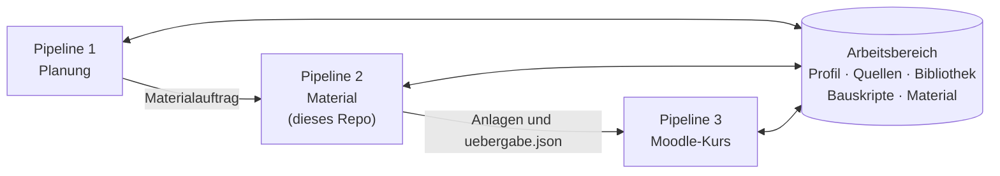
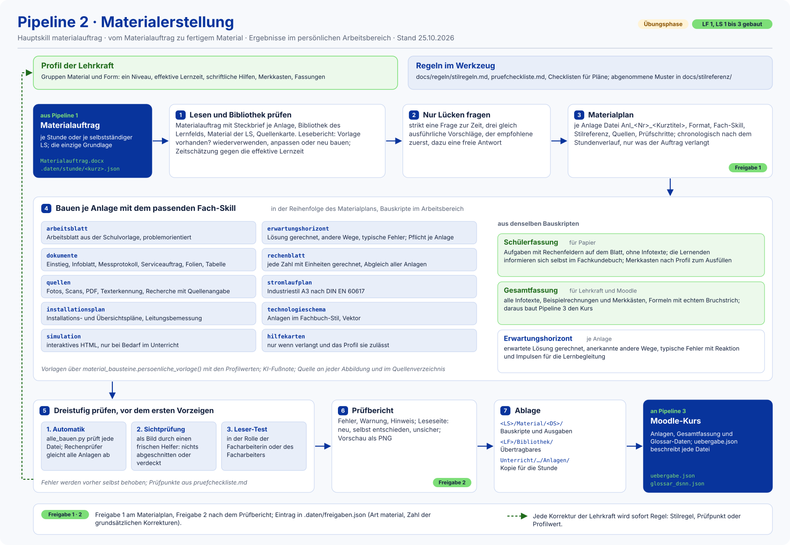

# Materialpipeline Referendariat (Pipeline 2: Material)

Aus dem freigegebenen **Materialauftrag** einer Stunde oder einer selbstständigen Lernsituation (aus der
[Unterrichtspipeline](../unterrichtspipeline-referendariat)) entsteht hier fertiges,
handlungsorientiertes Unterrichtsmaterial: DOCX, XLSX, PPTX und interaktive HTML-Simulationen. Die
[Moodle-Pipeline](../moodlepipeline-referendariat) baut daraus den Moodle-Kurs.



**Werkzeug und Arbeitsbereich sind getrennt (seit 2026-10-19, wie Pipeline 1).** Dieses Repo ist nur das Werkzeug.
Material, Bauskripte, Fotos, Bibliothek, eigene Quellen und das Lehrkraft-Profil liegen im gemeinsamen persönlichen
Arbeitsbereich aller Pipelines (`unterrichtspipeline-referendariat-<name>`). `python3 werkzeug/arbeitsbereich.py`
findet ihn und zeigt die Profilwerte der Gruppen „Material“ und „Form“. Ergebnisse werden nie ins Werkzeug
geschrieben.

## Ablauf mit Freigaben

Hauptskill `materialauftrag`:



Quelle der Grafik: [`docs/visualisierung/ablauf_grafik.py`](docs/visualisierung/ablauf_grafik.py) erzeugt das SVG
(Vektor, Schulfarben; `python3 docs/visualisierung/ablauf_grafik.py`).

- **Leseseite** (Profil `freigabe.leseseite`): Der Prüfbericht beginnt mit dem, was neu ist, was die KI selbst
  entschieden hat und wo sie unsicher ist, je mit Verweis.
- **Korrekturzähler:** Jede Freigabe wird in `.daten/freigaben.json` im Arbeitsbereich eingetragen (Art `material`,
  Zahl der grundsätzlichen Korrekturen). Zweimal hintereinander ohne grundsätzliche Korrektur reicht künftig ein
  Gesamtblick; nach der Freigabe von LS 3 (neun grundsätzliche Korrekturen) ist das beim Material noch nicht erreicht.
  Nach drei Freigaben einer Materialart ohne inhaltliche Änderung schlägt die Pipeline vor, Freigabe 1 für diese Art
  wegzulassen.
- Jede Korrektur der Lehrkraft wird sofort Regel: in [`docs/regeln/stilregeln.md`](docs/regeln/stilregeln.md), als
  Prüfpunkt in [`docs/regeln/pruefcheckliste.md`](docs/regeln/pruefcheckliste.md) oder als Profilwert; jede
  Entscheidung steht in [`docs/KONZEPT.md`](docs/KONZEPT.md).

## Skills

| Skill | Aufgabe |
|---|---|
| `materialauftrag` | Hauptablauf (oben) |
| `arbeitsblatt` | Arbeitsblatt aus der Schulvorlage, problemorientiert, mit Rechen- und Skizzenfeldern |
| `erwartungshorizont` | erwartete Lösung gerechnet, andere Wege, typische Fehler mit Reaktion (Pflicht je Anlage) |
| `hilfekarten` | gestufte Hilfekarten, nur wenn verlangt und vom Profil nicht abgeschaltet (`material.schriftliche_hilfen`) |
| `dokumente` | Einstieg, Infoblatt, Datenblatt, Messprotokoll, Serviceauftrag und -bericht, Selbstkontrolle, Karte A5, Tafelbild, Folien (PPTX), Tabelle (XLSX) |
| `rechenblatt` | Rechenprüfer mit Einheiten (Pint, Gegenprobe lcapy), Abgleich aller Anlagen, Diagramme aus derselben Rechnung |
| `quellen` | Fotos, Scans und PDF aufnehmen, Texterkennung, Quellenkarte, Volltextsuche, Recherche |
| `stromlaufplan` | Stromlaufpläne im Industriestil A3 (DIN EN 60617) |
| `installationsplan` | Installations-, Übersichts- und Verteiler-Übersichtsschaltpläne mit Leitungsbemessung |
| `technologieschema` | Technologieschemata im Fachbuch-Stil (TikZ) |
| `simulation` | interaktive HTML-Simulationen, nur bei Bedarf im Unterricht |

## Bausteine für Arbeitsblätter

Die gemeinsamen Bausteine stehen in `werkzeug/vorlagen/stunde.py` (Import `import stunde as st`) und
`werkzeug/vorlagen/material_bausteine.py`:

- **Fortlaufende Arbeitsblätter** je Lernsituation wie ein Fachkundebuch (`st.arbeitsblaetter()`, `st.thema()`,
  `st.aufgabe()`, `st.schreibplatz()`; Profil `material.arbeitsblaetter_fortlaufend`).
- **Schüler- und Gesamtfassung** aus denselben Bauskripten (`st.fassung()`, `st.gesamt()`): die Schülerfassung für
  Papier mit Aufgaben und Rechenfeldern, ohne Infotexte (die Lernenden informieren sich im Fachkundebuch); die
  Gesamtfassung für Lehrkraft und Moodle mit allen Infotexten, Beispielrechnungen und Merkkästen.
- **Merkkasten** für neu eingeführte Formeln (`st.merkkasten()`), Farbe aus dem Profil (`material.merkkasten`): die
  Formel einmal mit ihren Umstellungen, darunter die Einheitengleichung (`st.einheitenzeile()`). In der Schülerfassung
  je nach Profil `material.merkkasten_schueler` als Lückenformel (neutraler Standard) oder leer und kariert mit
  Auftrag darüber.
- **Formeln mit echtem Bruchstrich** als Word-Formel (`st.formel()`, OMML; Profil `material.formeln_als_bruch`),
  Einheiten gerade, Hochzahlen mit `^`.
- **Quellenverzeichnis mit Kurzverweisen**: `st.quellen_registrieren()`, Kurzverweis `st.q(...)` wie „[3]“ an
  Abbildung, Fall oder Zitat, `st.quellenverzeichnis()` als eigene Seite am Ende.
- Persönliche Gestaltung über `material_bausteine.persoenliche_vorlage(...)`: Die Vorlage wird mit den Profilwerten
  in den Arbeitsbereich gebaut (`.daten/vorlagen/`); die Vorlagen im Werkzeug bleiben neutral.

## Regeln für Material

- Problemorientierter Einstieg: erst das Problem im Modellbetrieb, keine Arbeitsanweisung, die Methode oder
  Lösungsweg vorgibt, kein „gegeben/gesucht“.
- Vorerst ein Niveau; Lernende sind Facharbeiter/innen im Modellbetrieb, Ansprache in der Sie-Form.
- Jede Lösung wird gerechnet, nicht geschätzt; Erwartungshorizont je Anlage.
- Quelle an jeder Abbildung und im Quellenverzeichnis; KI-Fußnote auf jedem KI-gestützten Material
  (Seminarvorgabe; Seminarprofil nach Profilwert `seminar`).
- Technische Grafiken als Vektor, normgerecht (DIN EN 60617); keine KI-Bilder für Schaltpläne.
- Keine echten Namen von Lernenden (nur Kürzel), keine Modellbezeichnungen in Dateien, die ins Repo gehen.
- Arbeitsweise mit der Lehrkraft: eine Frage zur Zeit mit drei gleich ausführlichen Vorschlägen und freier Antwort;
  passt eine Entscheidung nicht, widerspricht die KI begründet und nennt eine Alternative.
- Persönliche Vorlieben nie fest ins Werkzeug, sondern als Profilwert mit neutralem Standard.
- **Übungsphase und Echtbetrieb:** Bis zum eigenen Unterricht werden Stil und Verfahren geübt; Inhalte wie Modellbetrieb
  und Kunde sind Probe. Im Echtbetrieb beginnt die Arbeit beim vorhandenen Material von Schule und Kollegium.
- **Erst testen, dann pushen:** nach jeder Änderung am Werkzeug `python3 werkzeug/vorlagen/alle_bauen.py` und die
  betroffenen Bauskripte im Arbeitsbereich laufen lassen.

## Aktueller Stand (25.10.2026)

- **Übungsphase** wie in Pipeline 1: Stil und Verfahren werden geübt, Modellbetrieb und Kunden sind Probe.
- **LF 1, Lernsituationen 1 bis 3** gebaut und freigegeben. LS 3 ist die erste selbstständige Lernsituation: ein
  fortlaufendes Dokument je LS als Schülerfassung (44 Seiten) und Gesamtfassung (55 Seiten), Arbeitsplan als Anl. 1.
- Neu seit dem 24. und 25.10.2026: Fachwörter als Glossar-Daten für Moodle statt gedrucktem Wortspeicher, Fall- und
  Infokarten als Aufgabe im Arbeitsblatt, Formeln mit echtem Bruchstrich, schriftliche Hilfen per Profil abschaltbar
  (Impulse stehen dann im Erwartungshorizont).
- Letzter Lauf von `python3 werkzeug/vorlagen/alle_bauen.py`: 24 DOCX ohne Probleme.

## Beispielausgaben

Abgenommene Muster in [`docs/stilreferenz/`](docs/stilreferenz/) (fiktiv, zum Zeigen):

| Materialart | Beispiel |
|---|---|
| Stromlaufplan A3 (DIN EN 60617) | [`schaltplan_wendeschuetz_a3.png`](docs/stilreferenz/schaltplan_wendeschuetz_a3.png), [`schaltplan_sterndreieck_a3.png`](docs/stilreferenz/schaltplan_sterndreieck_a3.png) |
| Installationsplan | [`installationsplan_wohnung_a3.png`](docs/stilreferenz/installationsplan_wohnung_a3.png) |
| Technologieschema | [`technologieschema_foerderband.png`](docs/stilreferenz/technologieschema_foerderband.png) |
| Kennlinie aus dem Rechenprüfer | [`kennlinie_pt100.png`](docs/stilreferenz/kennlinie_pt100.png) |
| Interaktive Simulation | [`simulation_wendeschuetz.png`](docs/stilreferenz/simulation_wendeschuetz.png) (Bild), [`simulation_wendeschuetz.html`](docs/stilreferenz/simulation_wendeschuetz.html) |
| Arbeitsblätter, Karten, Formulare der Probe LS 1 | [`probe_ls01/README.md`](docs/stilreferenz/probe_ls01/README.md) |

## Schnellstart

1. `bash werkzeug/einrichten.sh` (einmal; installiert nur, was fehlt).
2. `python3 werkzeug/arbeitsbereich.py` findet den Arbeitsbereich und zeigt die Profilwerte.
3. Sagen, was gebaut werden soll, zum Beispiel „Material für LS 3 bauen“ oder „setz den Auftrag für DS 5 um“; der
   Skill `materialauftrag` führt durch den Ablauf oben.

## Einrichtung

```bash
bash werkzeug/einrichten.sh            # installiert nur, was fehlt
bash werkzeug/einrichten.sh --probe    # danach alle Stilreferenzen mit allen Prüfungen neu bauen
```

Das Skript installiert LuaLaTeX mit TikZ, pgfplots und circuitikz, die Schrift Liberation Sans, poppler, LibreOffice
(Writer, Impress, Calc), Tesseract (Deutsch) und die Python-Pakete aus
[`werkzeug/vorlagen/anforderungen.txt`](werkzeug/vorlagen/anforderungen.txt) (u. a. python-docx, docxtpl, python-pptx,
openpyxl, pint, pymupdf, segno), lcapy ohne Abhängigkeiten. Für die Vorschau der Word-Formeln braucht LibreOffice
zusätzlich **`libreoffice-math`** (installiert `werkzeug/einrichten.sh` mit). Einzelne Punkte des
Probelaufs: `python3 werkzeug/probelauf.py sterndreieck`. In Cloud-Sitzungen laufen Einrichtung und Probelauf beim
Start automatisch (`.claude/hooks/session-start.sh`).

## Ordner

| Ordner | Inhalt |
|---|---|
| `.claude/skills/` | die elf Skills (oben) |
| `vorlagen/` | neutrale DOCX-, PPTX- und XLSX-Vorlagen, Logo, Symbole |
| `werkzeug/vorlagen/` | Vorlagenbau, Bausteine (`stunde.py`, `material_bausteine.py`), Prüfung aller Vorlagen (`alle_bauen.py`) |
| `werkzeug/rechnen/` | Rechenprüfer und Diagramme |
| `werkzeug/schaltplan/`, `schaltzeichen/`, `installationsplan/`, `uebersichtsschaltplan/`, `technologieschema/`, `simulation/` | Grafik- und Plan-Werkzeuge |
| `werkzeug/quellen/`, `werkzeug/audio/` | Quellen aufnehmen und durchsuchen, Sprachausgabe |
| `werkzeug/uebergabe.py`, `paket.py`, `probelauf.py`, `skills_pruefen.py`, `arbeitsbereich.py` | Übergabe an Pipeline 3, Gesamt-PDF auf Anforderung, Probelauf, Skill-Prüfung, Arbeitsbereich finden |
| `docs/KONZEPT.md` | Konzept und Entscheidungsprotokoll |
| `docs/regeln/` | Stilregeln, Prüfcheckliste, Checklisten für Schalt-, Installations- und Übersichtsschaltpläne |
| `docs/schnittstellen/` | Übergabe an Pipeline 3, Hinweise an Pipeline 1 |
| `docs/stilreferenz/` | abgenommene Muster als Maßstab (Few-Shot-Beispiele) |
| `docs/recherche/`, `docs/probe/`, `docs/handover/` | Recherchen, Probeprotokolle, Übergaben |
| `docs/visualisierung/` | Ablaufgrafik der README (SVG) und ihr Erzeugungsskript |

Im **Arbeitsbereich** gehört dazu: `Quellen/` (mit Quellenkarte in `_karte/`), `<Fach>/<Beruf>/<LF>/Bibliothek/`
(Material über eine Lernsituation hinaus), `<Fach>/<Beruf>/<LF>/<LS>/Material/` (Bauskripte und Ausgaben je
Doppelstunde oder Meilenstein) und `Unterricht/…/<Stunde>/Anlagen/` (fertige Anlagen mit `uebergabe.json`).
