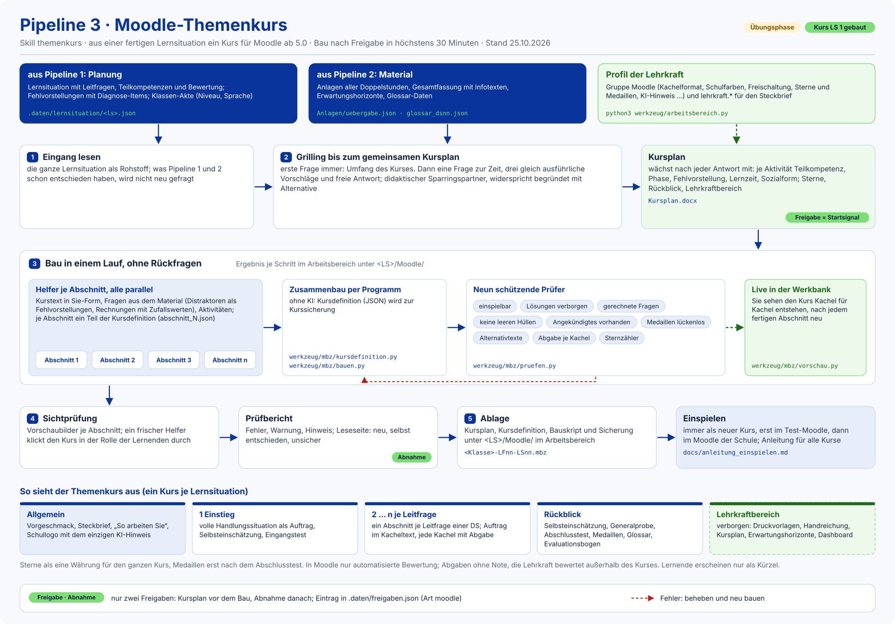

# Moodle-Pipeline Referendariat (Pipeline 3: Moodle-Kurs)

Dritte von drei Pipelines: Aus einer fertigen Lernsituation (Planung aus der
[Unterrichtspipeline](../unterrichtspipeline-referendariat), Material aller Doppelstunden aus
der [Materialpipeline](../materialpipeline-referendariat) mit `uebergabe.json`) entsteht ein
**Moodle-Themenkurs** als einspielbare Kurssicherung (`.mbz`). Ziel ist ein schneller, schlanker Kursbau für den
Moodle-Kern ab 5.0, erprobt mit Moodle 5.1.6.

**Zweck:** Die Lernenden bekommen zu jeder Lernsituation einen Kurs, in dem sie den Auftrag selbstständig bearbeiten,
sich selbst prüfen und Sterne sammeln; die Lehrkraft baut ihn nicht von Hand, sondern gibt nur den Kursplan frei und
nimmt den fertigen Kurs ab.

**Werkzeug und Arbeitsbereich sind getrennt** (wie Pipeline 1 und 2): Dieses Repo enthält nur Allgemeines. Kursplan,
Bauskripte, fertige Kurse und das Lehrkraft-Profil (Gruppe „Moodle“ und `lehrkraft.*`) liegen im gemeinsamen
Arbeitsbereich `unterrichtspipeline-referendariat-<name>`, die Kurse unter `<Fach>/<Beruf>/<LF>/<LS>/Moodle/`.
`python3 werkzeug/arbeitsbereich.py` findet ihn und zeigt die Profilwerte.

## Ablauf mit Freigaben

Skill `themenkurs`:

Quelle der Grafik: [`docs/visualisierung/ablauf_grafik.py`](docs/visualisierung/ablauf_grafik.py) erzeugt das SVG
(Vektor, Schulfarben; `python3 docs/visualisierung/ablauf_grafik.py`).

- **Direkt bauen:** Freigaben gibt es nur am Kursplan (vor dem Bau) und bei der Abnahme, keine Zwischenübersichten.
- **Grilling als didaktischer Sparringspartner:** jede Aktivität im Kursplan trägt ihre Begründung (Teilkompetenz,
  Phase der vollständigen Handlung, Fehlvorstellung, Lernzeit, Sozialform). Passt eine Antwort nicht, widerspricht
  die KI begründet und nennt eine Alternative.
- **Leseseite und Korrekturzähler** gelten wie in Pipeline 1: Die Abnahme wird in `.daten/freigaben.json` des
  Arbeitsbereichs eingetragen (Art `moodle`).
- **Live in der Werkbank:** `werkzeug/mbz/vorschau.py` zeigt den Kurs Kachel für Kachel, schon während er entsteht.

## Aufbau eines Themenkurses

Ein Themenkurs je Lernsituation; den Lernfeldkurs der Klasse legt die Lehrkraft selbst an und verlinkt die
Themenkurse. Fester Rahmen, sonst keine Pflichtbausteine:

- **Allgemein:** Vorgeschmack auf die Situation, Steckbrief, „So arbeiten Sie in diesem Kurs“, Schullogo und der
  einzige KI-Hinweis im Kurs (jeweils per Profilschalter).
- **Kachel 1 Einstieg:** volle Handlungssituation als Auftrag, Selbsteinschätzung und Eingangstest.
- **Je Leitfrage einer Doppelstunde ein Abschnitt** (Kachel), Auftrag im Kacheltext, Aktivitäten in der Reihenfolge der
  Arbeit; jede inhaltliche Kachel hat eine Form von Abgabe.
- **Sterne als eine Währung** für den ganzen Kurs (Tests, Stern „selbst gelöst“ je Kachel), Medaillen erst nach dem
  Abschlusstest.
- **Rückblick:** Selbsteinschätzung, Generalprobe, Abschlusstest, Medaillen, Glossar zum Nachschlagen (aus
  `glossar_dsnn.json` von Pipeline 2), anonymer Evaluationsbogen.
- **Verborgener Lehrkraftbereich:** Druckvorlagen aus Pipeline 2, Handreichung, Kursplan, Erwartungshorizonte,
  Lernstand-Dashboard.
- Material aus Pipeline 2 wird nach dem [Umsetzungskatalog](docs/regeln/umsetzungskatalog.md) umgesetzt (z. B.
  Word-Datei als Infoseite, Rechenaufgaben als berechnete Fragen mit Zufallswerten). Formeln mit Bruchstrich sollen als
  TeX für den MathJax-Filter erscheinen (entschieden 2026-10-25, im Kursbau noch umzusetzen).

## Werkzeuge

| Datei | Aufgabe |
|---|---|
| `werkzeug/arbeitsbereich.py` | Arbeitsbereich und Profil finden |
| `werkzeug/kursplan.py` | Kursplan als DOCX aus `kursplan.json` |
| `werkzeug/mbz/kursdefinition.py` | Format und Prüfung der Kursdefinition (JSON) |
| `werkzeug/mbz/bauen.py` | Zusammenbau der Kurssicherung, ohne KI |
| `werkzeug/mbz/pruefen.py` | neun schützende Prüfer (Einspielbarkeit, verborgene Lösungen, gerechnete Fragen, keine leeren Hüllen, Angekündigtes vorhanden, Medaillen, Alternativtexte, Abgabe je Kachel, Sternzähler) |
| `werkzeug/mbz/allgemein.py`, `sterne.py`, `fragen.py`, `docx_seite.py`, `pdf_formular.py`, `profilwerte.py` | Abschnitt „Allgemein“, Sterne und Medaillen, Fragen-XML, Word als Moodle-Seite, ausfüllbares PDF, Profilwerte |
| `werkzeug/mbz/vorschau.py` | Kursvorschau für die Werkbank |
| `werkzeug/mbz/beispiel.py` | fiktiver Beispielkurs mit allen Prüfern |
| `werkzeug/testmoodle/einspielen.sh` | echtes Einspielen in ein frisches Moodle 5.1.6 im Container und Nachzählen |
| `werkzeug/muster/infoblatt_moodle.py` | Muster: Infoblatt als Moodle-Textseite |

Tests: `python3 -m pytest werkzeug/mbz/tests`.

## Aktueller Stand (25.10.2026)

- **Übungsphase** wie in Pipeline 1 und 2: Stil und Verfahren werden geübt.
- Ein Themenkurs ist gebaut: LF 1, LS 1 (Kurssicherung im Arbeitsbereich unter `<LS>/Moodle/`). Als Nächstes folgt
  der Kurs zu LS 2 (Fahrplan 1.5); ab LS 3 ist der Kurs der Lernpfad zur selbstständigen Lernsituation.
- Neu entschieden am 24. und 25.10.2026: gestufte Hilfen in Moodle digital (aufklappbar), Glossar aus den
  Glossar-Daten von Pipeline 2, anonymer Evaluationsbogen im Rückblick, Formeln als TeX für den MathJax-Filter (im
  Kursbau noch umzusetzen; zu prüfen, ob der Filter im Moodle der Schule aktiv ist).

## Beispielausgaben

- `python3 werkzeug/mbz/beispiel.py` baut einen fiktiven Beispielkurs mit allen Prüfern (gut zum Vorführen).
- `python3 werkzeug/kursplan.py` erzeugt den Kursplan als DOCX aus `kursplan.json`.
- [`docs/anleitung_einspielen.md`](docs/anleitung_einspielen.md) zeigt, wie ein Kurs im Moodle der Schule als neuer
  Kurs eingespielt wird.

## Schnellstart

1. Python 3 mit `python-docx` und `pymupdf` bereitstellen (siehe „Einrichtung“).
2. `python3 werkzeug/arbeitsbereich.py` findet den Arbeitsbereich und zeigt die Profilwerte der Gruppe „Moodle“.
3. Sagen, welcher Kurs entstehen soll, zum Beispiel „Moodle-Kurs zu LS 2“; der Skill `themenkurs` beginnt mit der
   Frage nach dem Umfang und baut nach der Freigabe des Kursplans in einem Lauf.

## Einrichtung

Python 3 mit `python-docx` und `pymupdf` (für ausfüllbare PDF), `pytest` für die Tests; für die Umwandlung von Word
nach PDF Word (unter Windows) oder LibreOffice (`soffice`). Das Einspielen im Container (`einspielen.sh`) braucht PHP 8.3 und PostgreSQL 16 und
lädt Moodle 5.1.6 beim ersten Lauf selbst herunter. Kurse werden im Moodle der Schule immer **als neuer Kurs**
eingespielt: [`docs/anleitung_einspielen.md`](docs/anleitung_einspielen.md).

## Ordner

| Ordner | Inhalt |
|---|---|
| `.claude/skills/themenkurs/` | Hauptablauf |
| `werkzeug/` | Kursplan, Kursbau (`mbz/`), Test-Moodle, Muster |
| `docs/KONZEPT.md` | Wünsche der Lehrkraft und Entscheidungsprotokoll |
| `docs/regeln/umsetzungskatalog.md` | Material aus Pipeline 2 → Moodle-Aktivität |
| `docs/schnittstellen/` | Hinweise an Pipeline 1 und 2 |
| `docs/anleitung_einspielen.md` | Einspiel-Anleitung für alle Themenkurse |
| `docs/superpowers/plans/` | Umbaupläne aus der Kursdurchsicht |
| `docs/visualisierung/` | Ablaufgrafik der README (SVG) und ihr Erzeugungsskript |

## Wichtigste Regeln

- Wenig Input auf einmal: ein Punkt zur Zeit, strikt eine Frage zur Zeit, drei gleich ausführliche Vorschläge und
  freie Antwort.
- Jede Entscheidung sofort in `docs/KONZEPT.md`, jede Korrektur der Lehrkraft sofort als Regel.
- Persönliches nur als Profilwert im Arbeitsbereich; die Profil-Vorlage in Pipeline 1 bleibt neutral.
- In Moodle nur automatisierte Bewertung; Abgaben ohne Note, die Lehrkraft bewertet außerhalb des Kurses.
- Übungsphase und Echtbetrieb wie in Pipeline 1: Bis zum eigenen Unterricht werden Stil und Verfahren geübt.
- Keine Namen von Lernenden (nur Kürzel), keine Modellbezeichnungen in Dateien, die ins Repo gehen; Sie-Form.
- Datenschutz im Kurs: Abgaben und Lernstand sieht nur die Lehrkraft; Lernende legen keine öffentlichen Einträge an
  (Glossar nur zum Nachschlagen, Begriffswand als Test); der Evaluationsbogen ist anonym; genau ein KI-Hinweis im
  Abschnitt „Allgemein“.
