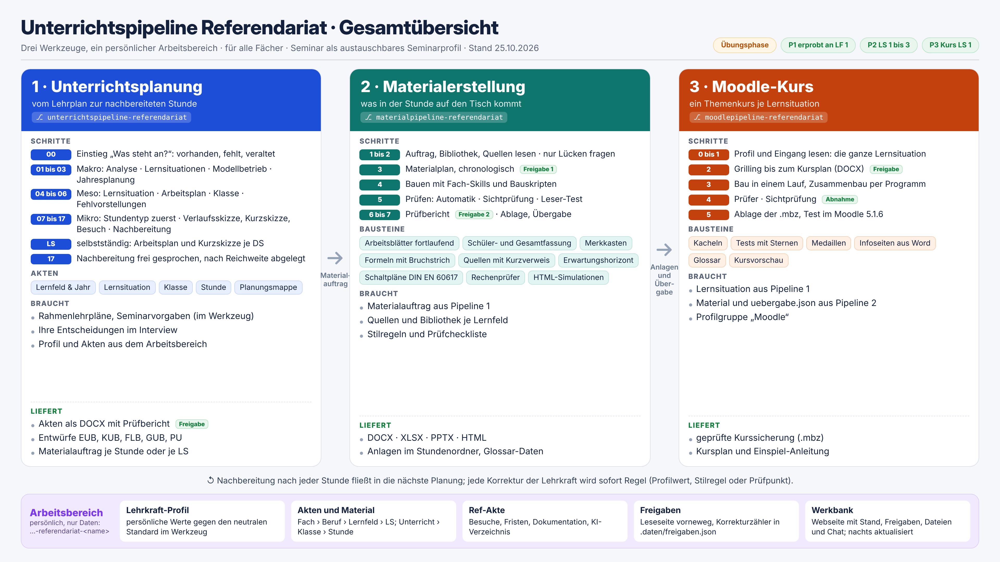
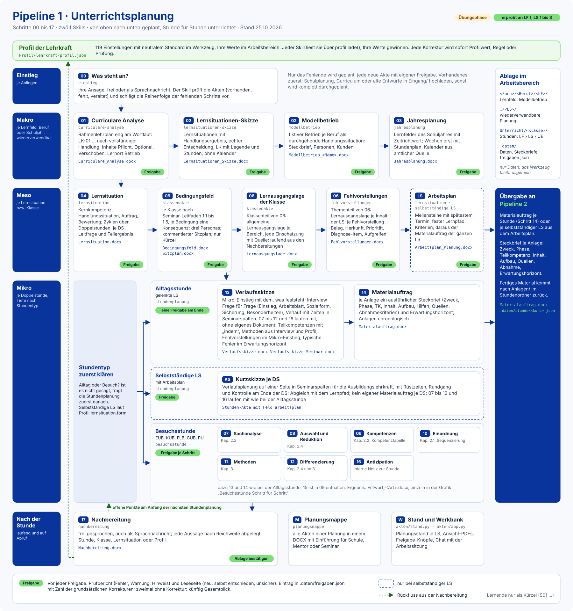
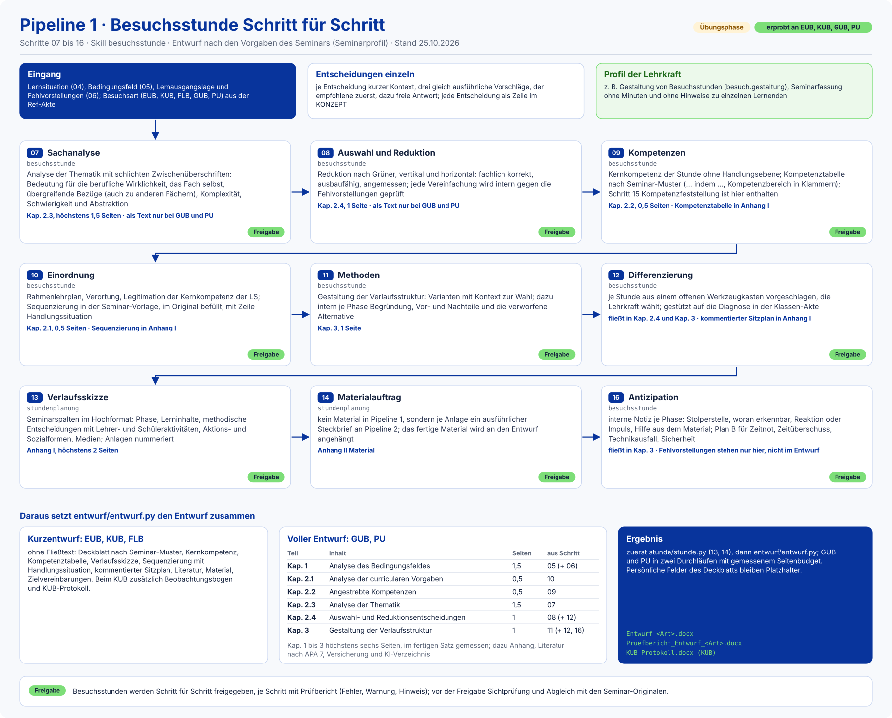

# Unterrichtspipeline Referendariat (Pipeline 1: Planung)

KI-gestützte Unterrichtsplanung an berufsbildenden Schulen (BBS; Seminar als austauschbares Seminarprofil, mitgeliefert Studienseminar Osnabrück, LBS). Die Lehrkraft
entscheidet; das System fragt, entwirft, prüft und dokumentiert.

**Zweck:** Planung und Ref-Dokumentation sollen weniger Zeit kosten, ohne dass die Lehrkraft die didaktischen
Entscheidungen abgibt. Aus dem Rahmenlehrplan entstehen Schritt für Schritt Lernsituationen, Stundenplanungen,
Besuchsentwürfe nach Seminarvorgabe und ein Materialauftrag, den Pipeline 2 und 3 weiterverarbeiten.

**Fächer:** Elektrotechnik (berufliche Fachrichtung) und Mathematik (Unterrichtsfach).



Quelle der Grafik: [`docs/visualisierung/gesamtuebersicht.html`](docs/visualisierung/gesamtuebersicht.html)
(1920 × 1080, als PNG mit doppelter Pixeldichte aus Chromium im Kopflosbetrieb aufgenommen).

## Drei Werkzeuge, ein Arbeitsbereich

| Repository | Aufgabe |
|---|---|
| **`unterrichtspipeline-referendariat`** (dieses Repo) | Pipeline 1: vom Rahmenlehrplan bis zur nachbereiteten Stunde; Entwürfe für Unterrichtsbesuche; Materialauftrag; Lehrkraft-Profil (Vorlage); Werkbank-Daten |
| [`materialpipeline-referendariat`](../materialpipeline-referendariat) | Pipeline 2: setzt den Materialauftrag in fertiges Material um (DOCX, XLSX, PPTX, HTML) |
| [`moodlepipeline-referendariat`](../moodlepipeline-referendariat) | Pipeline 3: baut aus Planung und Material einer Lernsituation einen Moodle-Themenkurs (.mbz) |
| `unterrichtspipeline-referendariat-<name>` | persönlicher Arbeitsbereich der Lehrkraft: Profil, Akten, Material, Kurse, Ref-Akte (nur Daten) |

**Werkzeug und Arbeitsbereich sind getrennt.** Die drei Werkzeug-Repos enthalten nur Allgemeines (Skills, Generatoren,
Regeln, neutrale Vorlagen). Alles, was einer Lehrkraft gehört, liegt im gemeinsamen Arbeitsbereich aller Pipelines;
die Skills schreiben ihre Ergebnisse nur dorthin. `akten/arbeitsbereich.py` findet ihn über die Umgebungsvariable
`UPR_ARBEITSBEREICH`, die Datei `.arbeitsbereich` im Werkzeug oder genau einen Nachbarordner
`unterrichtspipeline-referendariat-*` mit `Profil/lehrkraft-profil.json`.

## Wie Pipeline 1 arbeitet



Quelle der Grafik: [`docs/visualisierung/ablauf_grafik.py`](docs/visualisierung/ablauf_grafik.py) erzeugt dieses SVG
und die Grafik zur Besuchsstunde unten (Vektor, Schulfarben; `python3 docs/visualisierung/ablauf_grafik.py`).

Geplant wird von oben nach unten, unterrichtet Stunde für Stunde. Jeder Schritt hat einen Skill in `.claude/skills/`
und einen Generator, der das Dokument aus Daten in `.daten/` des Arbeitsbereichs erzeugt und selbst prüft.

| Ebene | Schritte | Skill | Generator |
|---|---|---|---|
| Einstieg | 00 „Was steht an?“: vorhanden, fehlt, veraltet; Reihenfolge der fehlenden Schritte | `einstieg` | `akten/akten.py`, `akten/bedarf.py` |
| Makro (Lernfeld, Schuljahr) | 01 Curriculare Analyse | `curriculare-analyse` | `lernfeld/curriculare_analyse.py` |
| | 02 Lernsituationen-Skizze, Modellbetrieb | `lernsituationen-skizze`, `modellbetrieb` | `lernfeld/ls_skizze.py`, `modellbetrieb/modellbetrieb.py` |
| | 03 Jahresplanung (Kalender aus amtlicher Quelle) | `jahresplanung` | `jahresplanung/jahresplanung.py` |
| Meso (Lernsituation, Klasse) | 04 Lernsituation ausarbeiten | `lernsituation` | `lernsituation/ls_ausarbeitung.py` |
| | selbstständige LS: Arbeitsplan mit Meilensteinen und Lernpfad | `lernsituation` | `lernsituation/arbeitsplan.py` |
| | 05 und 06 Klassen-Akte (Bedingungsfeld, Personas, Sitzplan) | `klassenakte` | `klasse/klassenakte.py`, `klasse/sitzplan_bild.py` |
| | 06 Lernausgangslage und Fehlvorstellungen | `fehlvorstellungen` | `lernsituation/fehlvorstellungen.py` |
| Mikro (Doppelstunde) | 13 Verlaufsskizze, 14 Materialauftrag; bei selbstständiger LS eine Kurzskizze je DS | `stundenplanung` | `stunde/stunde.py` |
| | 07 bis 12 und 16 für Besuchsstunden: EUB, KUB, FLB (Kurzentwurf), GUB, PU (voller Entwurf mit Seitenbudget) | `besuchsstunde` | `entwurf/entwurf.py`, `entwurf/voll.py` |
| Nachbereitung | 17 frei gesprochen, nach Reichweite abgelegt (Stunde, Klasse, Lernsituation, Profil) | `nachbereitung` | `nachbereitung/nachbereitung.py` |
| Zum Zeigen | Planungsmappe für Schule, Mentor oder Seminar | `planungsmappe` | `mappe/planungsmappe.py` |

**Selbstständige Lernsituation (Grundkonzept Elektrotechnik, seit 2026-10-25, Profil `lernsituation.form`):**
Die Lehrkraft stellt zu Beginn die Handlungssituation vor; die Lernenden arbeiten einen festen Lernpfad aus
Arbeitsblättern selbstständig ab, mit Meilensteinen und spätestem Termin. `lernsituation/arbeitsplan.py` erzeugt aus
`.daten/arbeitsplan/<ls>.json` den `Arbeitsplan_Planung.docx` und, sobald der Lernpfad Steckbriefe hat, den
Materialauftrag der ganzen LS für Pipeline 2. Je Doppelstunde gibt es dann eine **Kurzskizze**: eine Verlaufsplanung
auf einer Seite in Seminarspalten (Stunden-Akte mit Feld `arbeitsplan`); die volle Verlaufsskizze bleibt den
Besuchsstunden vorbehalten.

**Didaktik in jeder Stunde, Tiefe nach Stundentyp:** Die Schritte 07 bis 12 und 16 laufen auch in der Alltagsstunde
mit, nur ohne eigenes Dokument (Grundsatz: ausgearbeitet wird, was abgegeben oder im Unterricht gebraucht wird).

| Schritt | Alltagsstunde | Besuchsstunde |
|---|---|---|
| 07 Sachanalyse, 08 Auswahl und Reduktion | im Hintergrund, so weit Verlaufsskizze und Material es brauchen | eigener Schritt; als Text bei GUB und PU (Kap. 2.3, 2.4) |
| 09 Kompetenzen | Teilkompetenzen mit „indem“ in der Verlaufsskizze | Kompetenztabelle (Kap. 2.2) |
| 10 Einordnung | aus der Lernsituation (Leitfrage, DS, Teilergebnis) | Sequenzierung (Kap. 2.1) |
| 11 Methoden | Interviewfragen Einstieg, Arbeitsblatt, Sozialform, Sicherung und das Profil | Varianten mit Begründung (Kap. 3) |
| 12 Differenzierung | in Material und Profil, Impulse im Erwartungshorizont | Werkzeugkasten, kommentierter Sitzplan |
| 16 Antizipation | Fehlvorstellungen im Mikro-Einstieg, typische Fehler im Erwartungshorizont | interne Notiz je Phase, Plan B |

**Besuchsstunde Schritt für Schritt:** Für EUB, KUB, FLB, GUB und PU werden die Schritte 07 bis 12 und 16 einzeln
besprochen und freigegeben; die Grafik zeigt, was jeder Schritt enthält und in welches Kapitel des Entwurfs er eingeht.



**Seminarvorgaben haben Vorrang:** Seitenbudget des Entwurfs (Kapitel 1 bis 3 höchstens sechs Seiten, im fertigen Satz
gemessen), Arial 11, 1,5-zeilig, Blocksatz, APA 7, Seminarvorlagen im Original, KI-Übersicht und Versicherung. Für die
Seminarfassung erzeugt `stunde/stunde.py` zusätzlich `Verlaufsskizze_Seminar.docx`.

## Ablauf mit Freigaben

1. **Interview:** eine Frage zur Zeit, kurzer Kontext, drei gleich ausführliche Vorschläge (der empfohlene zuerst),
   dazu immer eine freie Antwort. Passt eine Entscheidung nicht, widerspricht die KI begründet und nennt eine
   Alternative.
2. **Generator** baut das Dokument (DOCX) und schreibt einen **Prüfbericht** mit Fehler, Warnung, Hinweis hinein.
3. **Leseseite** vor jeder Freigabe (Profil `freigabe.leseseite`): was neu ist, was die KI selbst entschieden hat,
   wo sie unsicher ist, je mit Verweis. Statt alles gegenzulesen, prüft die Lehrkraft diese Punkte.
4. **Freigabe** durch die Lehrkraft: Steckbrief in `.daten/akten/` auf `freigegeben`, Eintrag in
   `.daten/freigaben.json` mit Art (planung, material, moodle) und **Zahl der grundsätzlichen Korrekturen**. Zwei
   Freigaben einer Art hintereinander ohne grundsätzliche Korrektur: Für diese Art reicht künftig ein Gesamtblick.
5. **Festhalten:** jede Entscheidung als Zeile im Entscheidungsprotokoll von [`docs/KONZEPT.md`](docs/KONZEPT.md),
   jede Korrektur sofort als Regel (Profilwert, Regel in [`docs/ARBEITSWEISE.md`](docs/ARBEITSWEISE.md) oder Prüfung
   im Generator); dann commit und push in Werkzeug und Arbeitsbereich.

`python3 akten/akten.py <arbeitsbereich>` zeigt danach, welche Akten aktuell, veraltet oder ungeprüft sind.

## Lehrkraft-Profil

`profil/vorlage.json` beschreibt alle Einstellungen der drei Pipelines (derzeit 119 in den Gruppen Arbeitsweise,
Didaktik, Form, Fach und Quellen, Seminar, Material und Moodle) mit **neutralem Standard**. Persönliche Werte stehen
nur im Arbeitsbereich (`Profil/lehrkraft-profil.json`); `python3 profil/profil.py <arbeitsbereich>` prüft sie und
erzeugt `Lehrkraft-Profil.docx`. Skills lesen Werte nur über `profil.lade()`. Persönliche Vorlieben kommen nie fest
ins Werkzeug, sondern als Profilwert.

## Werkbank und lebende Übersicht

- `akten/stand.py <arbeitsbereich>` schreibt den Planungsstand (Doppelstunden, Grundlagen, Profilwerte, Skills der drei
  Pipelines) nach `.daten/stand/`.
- `akten/app.py <arbeitsbereich>` erzeugt dazu die Daten der **Werkbank**, einer privaten Webseite mit Fortschritt je
  Lernsituation (Planung, Material, Moodle), Freigabe-Knöpfen, Ordnerbaum mit Ansicht-PDFs (über LibreOffice),
  Profil-Schaltern, Kursvorschau und Chat mit der Arbeitssitzung. Nachrichten und Aufträge der Werkbank bearbeitet
  die Sitzung wie eine Ansage im Chat.
- Der Stand wird nach jeder Freigabe und zusätzlich jede Nacht durch eine geplante Aufgabe neu erzeugt.
- `akten/fahrplan.py <arbeitsbereich>` erzeugt aus `.daten/fahrplan.json` den Fahrplan der Personalisierung.

## Aktueller Stand (25.10.2026)

- **Übungsphase:** Erprobt wird an LF 1 (Elektroniker/in) mit Modellbetrieb und Musterklasse; geübt werden Stil und
  Verfahren, nicht die Inhalte.
- **Lernsituationen 1 bis 3** sind geplant und freigegeben, das Material dazu ist gebaut; LS 3 ist die erste
  selbstständige Lernsituation mit Arbeitsplan und Kurzskizzen je DS. Ein Moodle-Kurs liegt für LS 1 vor, LS 2 folgt.
- **Zeitplan:** ab 16.11.2026 Hospitation, eigener Unterricht ab Ende November oder Anfang Dezember 2026; dann
  beginnt der Echtbetrieb beim Ist-Stand der Schule.
- Offene Punkte: [`docs/KONZEPT.md`](docs/KONZEPT.md), Abschnitt „Bekannte Baustellen“, und der Fahrplan im
  Arbeitsbereich.

## Übungsphase und Echtbetrieb

Bis zum eigenen Unterricht ist die Arbeit eine **Übungsphase** für Stil- und Verfahrensentscheidungen; Modellbetrieb,
Kunden und Musterklasse sind Probe. Die KI entscheidet dort reine Inhaltsdetails selbst und nennt sie im Prüfbericht.
Im **Echtbetrieb** beginnt die Arbeit beim Ist-Stand (Klassen, Vorgaben, vorhandenes Material von Schule und
Kollegium); ein Modellbetrieb ist dann optional.

## Schnellstart

1. Werkzeug und einen Arbeitsbereich nebeneinander klonen (Gerüst: [`docs/arbeitsbereich/`](docs/arbeitsbereich/)),
   dann `python3 setup_laptop.py <pfad zum arbeitsbereich>`.
2. Die Arbeitssitzung in der Wurzel dieses Repositorys starten; die zwölf Skills werden dann gefunden.
3. Sagen, was ansteht, zum Beispiel „Ich muss LS 4 in LF 1 planen“ oder „nächste Woche ist mein GUB“. Der Einstieg
   (Schritt 00) prüft die Akten und schlägt die nächsten Schritte vor.

## Einrichtung

```bash
python3 setup_laptop.py [<pfad zum arbeitsbereich>]
```

prüft die Python-Pakete `python-docx` und `docxcompose`, merkt sich den Arbeitsbereich (Datei `.arbeitsbereich`, nicht
im Git) und räumt alte global installierte Skills der ersten Fassung nach Rückfrage weg. Die Skills werden gefunden,
wenn die Sitzung in der Wurzel dieses Repositorys startet. Zusätzlich nötig: **LibreOffice** (`soffice`) für die
Seitenmessung des vollen Entwurfs und die Ansicht-PDFs der Werkbank, **Chromium** (kopflos) für das Sitzplan-Bild.
Für Material mit Formeln (Pipeline 2) braucht die Vorschau außerdem `libreoffice-math`.

## Struktur

```text
├── .claude/skills/        die zwölf Skills von Pipeline 1 (eine Anleitung je Schritt)
├── akten/                 Steckbriefe, Bedarf, Stand, Werkbank (app.py), Fahrplan, Arbeitsbereich finden
├── lernfeld/              curriculare Analyse, Lernsituationen-Skizze
├── modellbetrieb/         Modellbetrieb je Beruf
├── jahresplanung/         Schuljahres-Akte, Schulkalender Niedersachsen
├── lernsituation/         Lernsituation, Arbeitsplan, Fehlvorstellungen
├── klasse/                Klassen-Akte, Sitzplan-Studio und Sitzplan-Bild
├── stunde/                Verlaufsskizze, Kurzskizze, Materialauftrag
├── entwurf/               Entwürfe für Unterrichtsbesuche (Kurzentwurf, voller Entwurf)
├── nachbereitung/         Nachbereitung nach Reichweite
├── mappe/                 Planungsmappe
├── profil/                Profil-Vorlage (neutral) und Prüfung
├── docs/
│   ├── KONZEPT.md         alle Entscheidungen und das Entscheidungsprotokoll
│   ├── ARBEITSWEISE.md    Regeln, die für jeden Skill gelten
│   ├── REF_DOKUMENTATION.md  Ref-Akte: Besuche, Fristen, Dokumentation
│   ├── arbeitsbereich/    Gerüst für einen neuen Arbeitsbereich
│   ├── beispiel-et-lf01/  durchgearbeitetes Demo-Beispiel (LF 1, LS 3, DS 7 als GUB)
│   ├── pipeline2/         Vorschlag und Übergabe an die Materialpipeline
│   ├── visualisierung/    Gesamtübersicht, Pipelines, Ebenen, Skill-Fahrplan (HTML und 4K-PNG), Ablauf (SVG)
│   ├── prototypen/        z. B. interaktiver Sitzplan
│   └── .erzeugung/        Skripte, die das Demo-Beispiel erzeugen
├── Ref/                   Gliederung GUB/PU, Legende der Besuchsarten
├── Quellen/, Quellen_downloads/   Leitfäden und Vorlagen (Seminar, SchuCu-BBS, KMK)
├── beispiele/daten/       Beispieldaten aus dem Probelauf LF 1
├── archiv/skills_fassung1/   Skills der ersten Fassung (nur zum Nachschlagen)
├── setup_laptop.py        Einrichtung
└── Dokumentation_Unterrichtsplanungs_Pipeline.docx   Handbuch der ersten Fassung
```

## Demo-Beispiel

Vollständig fiktiv und im Werkzeug, damit Neue sehen, was am Ende herauskommt: Elektroniker/in für Automatisierungs-
und Systemtechnik, LF 1, Lernsituation 3 „Der Temperaturfühler zeigt falsche Werte“, Doppelstunde 7 als GUB,
Modellbetrieb Brinkmann Automation (fiktiv). In [`docs/beispiel-et-lf01/`](docs/beispiel-et-lf01/) liegen die
Schritt-Dokumente 00 bis 16, der Entwurf mit Platzhaltern, ein abgabefertiges Muster und die Planungsmappe.

Gut zum Zeigen:

| Ausgabe | Datei |
|---|---|
| Curriculare Analyse und Lernsituationen-Skizze | [`01_curriculare_analyse.md`](docs/beispiel-et-lf01/01_curriculare_analyse.md), [`02_lernsituationen_skizze.md`](docs/beispiel-et-lf01/02_lernsituationen_skizze.md) |
| Fehlvorstellungen einer Lernsituation | [`06_LS03_Fehlvorstellungen.docx`](docs/beispiel-et-lf01/06_LS03_Fehlvorstellungen.docx) |
| Verlaufsskizze und Materialauftrag einer Doppelstunde | [`13_LS03_DS07_Verlaufsskizze.docx`](docs/beispiel-et-lf01/13_LS03_DS07_Verlaufsskizze.docx), [`14_LS03_DS07_Materialauftrag.docx`](docs/beispiel-et-lf01/14_LS03_DS07_Materialauftrag.docx) |
| GUB-Entwurf, abgabefertiges Muster | [`GUB_Entwurf_LS03_DS07_Muster.docx`](docs/beispiel-et-lf01/GUB_Entwurf_LS03_DS07_Muster.docx) |
| Planungsmappe für Außenstehende | [`Planungsmappe_LS03_DS07.pdf`](docs/beispiel-et-lf01/Planungsmappe_LS03_DS07.pdf) |

## Weitere Grafiken

Alle Seiten in [`docs/visualisierung/`](docs/visualisierung/) sind auf dem Stand vom 25.10.2026 (HTML als Quelle,
4K-PNG als Aufnahme):

- [`ablauf_unterrichtsplanung.svg`](docs/visualisierung/ablauf_unterrichtsplanung.svg): Ablauf der Schritte 00 bis 17
  (oben unter „Wie Pipeline 1 arbeitet“), jeder Schritt einzeln nummeriert, als Vektor aus `ablauf_grafik.py` mit den
  Bausteinen in `svgbau.py`.
- [`ablauf_besuchsstunde.svg`](docs/visualisierung/ablauf_besuchsstunde.svg): Besuchsstunde Schritt für Schritt
  (07 bis 16), Kurzentwurf und voller Entwurf mit Seitenbudget; aus demselben Skript.
- [`skillablauf.html`](docs/visualisierung/skillablauf.html): Skill-Fahrplan von Pipeline 1, jeder Skill mit Zeitpunkt,
  Eingang, Ergebnis und Profilwerten, Filter nach Stundentyp (zum Anklicken).
- [`pipeline1_unterrichtsplanung.html`](docs/visualisierung/pipeline1_unterrichtsplanung.html),
  [`pipeline2_materialerstellung.html`](docs/visualisierung/pipeline2_materialerstellung.html),
  [`pipeline3_moodle.html`](docs/visualisierung/pipeline3_moodle.html): jede Pipeline einzeln mit ihren Schritten und
  Freigaben.
- [`makroebene.html`](docs/visualisierung/makroebene.html), [`mesoebene.html`](docs/visualisierung/mesoebene.html)
  (dazu [`mesoebene_interaktiv.html`](docs/visualisierung/mesoebene_interaktiv.html)): die Planungsebenen im Detail.
- [`ebenen_und_ref_akte.html`](docs/visualisierung/ebenen_und_ref_akte.html): welcher Schritt in welchen Teil des
  Besuchsentwurfs eingeht und was von der Ref-Akte schon vorhanden oder erst geplant ist.

## Wichtigste Regeln

- Rangfolge: Ansage der Lehrkraft > Seminarvorgaben > vorhandenes Material der Schule > Vorgabe der Pipeline.
- Ausgaben für die Lehrkraft als DOCX (XLSX, PPTX, HTML, wo es passt), PDF nur auf Wunsch; interne Daten als JSON in
  `.daten/`.
- Lernende nur als Kürzel (S01 …), nie mit Namen; keine Modellbezeichnungen in Dateien, die ins Repository gehen.
- Problemorientierter Einstieg: das Material nimmt nichts vorweg, kein „gegeben/gesucht“.
- Erst testen, dann pushen: jeden geänderten Generator an einer echten Akte laufen lassen.

Offene Punkte stehen in [`docs/KONZEPT.md`](docs/KONZEPT.md) unter „Bekannte Baustellen“ und im Fahrplan der
Personalisierung im Arbeitsbereich.

## Datenschutz und KI-Transparenz

- Lernende erscheinen nur als Kürzel (S01 …), nie mit Namen; Klassen ohne echte Daten sind als Musterklasse
  gekennzeichnet.
- Das Werkzeug enthält nichts Persönliches. Echte Planungen, Profil und Ref-Akte liegen nur im privaten Arbeitsbereich
  der Lehrkraft; Git ist dort die Sicherung.
- Keine Modellbezeichnungen in Dateien, die ins Repository gehen.
- Besuchsentwürfe enthalten KI-Übersicht und Versicherung nach Seminarvorgabe; Material trägt eine KI-Fußnote
  (Pipeline 2), der Moodle-Kurs genau einen KI-Hinweis (Pipeline 3).

> **Privat:** Das Repository enthält Seminarunterlagen. Daten von Lernenden stehen nur anonymisiert (Kürzel) im
> Repository; echte Planungen liegen im Arbeitsbereich.
